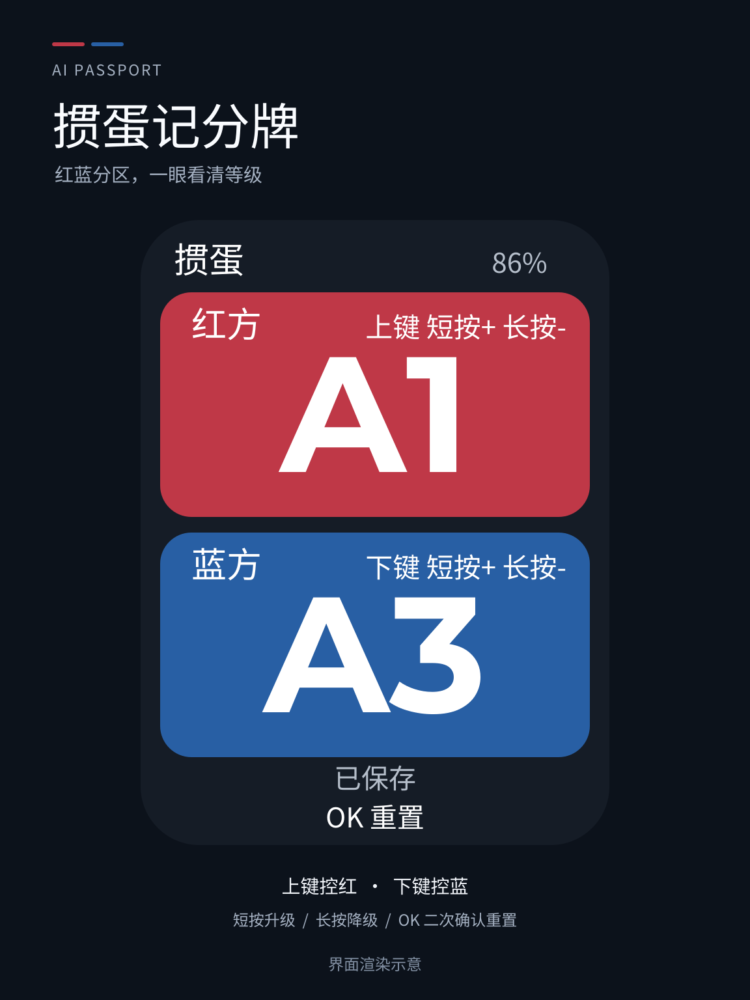

[简体中文](README.zh_CN.md) · **English**

# Guandan Scoreboard

A pocket scoreboard for two Guandan teams: red on top, blue below, with large
level labels. It works offline, saves progress locally, and asks for confirmation
before resetting both teams. Players decide round results and adjust levels manually.

<p align="center"></p>

*Interface rendering for illustration, not a photograph of the device.*

## Quick start

1. Turn on the device. No network setup is needed. First use starts both teams at `2`; later starts restore the last successfully saved levels.
2. Short-press **UP** to raise red or **DOWN** to raise blue. Hold the corresponding button for at least **650 ms** to lower that team once.
3. Short-press **OK**, then short-press **OK** again to reset both teams to `2`. UP or DOWN cancels; the prompt also expires after 8 seconds.
4. Wait for the saved indicator before switching off, then restart to continue. Recent unsaved changes may be lost if power is removed.

Levels stop at either end and never wrap:

```text
2  3  4  5  6  7  8  9  10  J  Q  K  A1  A2  A3
```

[Detailed controls and behavior](docs/applications/guandan.md)

## Install v1.0.0

Download the firmware and checksums from [Releases](https://github.com/cnLuca0702/GuanDan-ESP32/releases).
The full image is for the FoloToy AI Passport and is written at `0x0` using the
[official web flasher](https://ai-passport.folotoy.cn/tools/web-flasher/).

Installing replaces the running application. **Writing the merged full image can erase
saved settings and scores**, because its padding spans the storage area. If existing
settings must be retained, use the release package's segmented instructions only after
verifying that the device has the matching partition layout. Do not perform a full-chip erase.
See [firmware layout and stored data](docs/development/engineering/firmware-layout.md).

Tested full-image SHA-256:

```text
41b48f76bb0bd211a963b2a3de0008fab46e6836f01dce63b880a3186299e9ea
```

## Build and test

Use ESP-IDF **5.5.3**, target **esp32c3**, with an **8 MB** flash configuration.
Follow the [environment setup](docs/development/engineering/environment-setup.md), then:

```bash
git clone https://github.com/cnLuca0702/GuanDan-ESP32.git
cd GuanDan-ESP32
source tools/activate-esp.sh
./tools/validate.sh --static    # repository checks and host tests
./tools/validate.sh --firmware  # build, merge, verify, archive
```

The merged output is `build/FoloToy-AI-Passport-full.bin`.
Generated firmware, build directories, local credentials, and device logs are excluded
from Git. Release assets preserve the exact tested binary; a fresh build can have a
different hash because build metadata changes.

Default `main/CMakeLists.txt` builds **Guandan only**. Earlier Muyu code, baseline demos,
BSP, tests, and engineering documentation remain available as development references;
these are not selectable applications in this firmware.

## Validation of v1.0.0

- **Build: PASS.** Complete firmware gate and archive verification.
- **Host tests: PASS.** Includes 27 model/input groups, font coverage, 24 rendered UI states, and 2,000 UI transitions.
- **Device tests: PASS for the tested controls.** Display, upper/lower limits, short/long presses, cancellation with UP, two-OK reset, saving, and restoration of red 5 / blue 7 after reboot.
- **Unverified on hardware:** 8-second timeout, DOWN cancellation, exact long-press threshold, idle dimming/brightness recovery, battery runtime, and restoring the previous application. Logical input cases are covered by host tests.

See the [acceptance record](docs/applications/guandan.md#device-acceptance) for scope.
CI verifies builds but does not replace the tested release assets automatically.

## Source and license

Based on [FoloToy/ai-passport](https://github.com/FoloToy/ai-passport), with a separate
Guandan UI, input state machine, saved scores, fonts, tests, and documentation.
Code is distributed under the [MIT license](LICENSE), retaining the upstream notice.
Font subsets carry their own SIL OFL notices in `assets/fonts/`; see
[asset sources and licenses](assets/README.md). Brand/reference materials retain their
separate restrictions. The cover and reset illustration were created for this project.

[Engineering documentation](docs/README.md) · [Changelog](docs/CHANGELOG.md) ·
[Report an issue](https://github.com/cnLuca0702/GuanDan-ESP32/issues)
