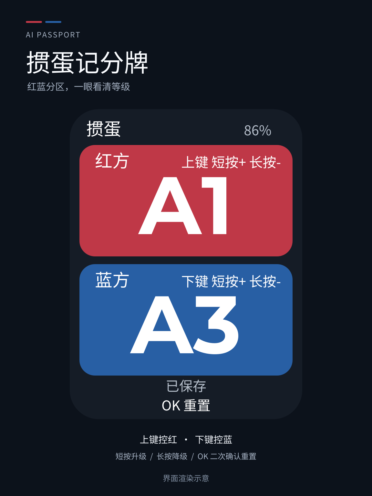

**简体中文** · [English](README.md)

# 掼蛋记分牌

随身使用的双队掼蛋记分牌：上排红队、下排蓝队，大号等级一眼看清。
离线使用，自动保存进度，重置需要二次确认。由玩家判断牌局结果并手动调整等级。

<p align="center"></p>

*图片为界面渲染示意，不是实机照片。*

## 快速上手

1. 开机即可使用，无需配网。首次双方均为 `2`，有记录时恢复上次成功保存的等级。
2. **短按上键**让红队加一级，**短按下键**让蓝队加一级；按住对应键至少 **650 毫秒**减一级，每次长按只减一次。
3. **短按 OK，再次短按 OK**，双方恢复到 `2`。确认框中按上键或下键取消，8 秒不确认也会取消。
4. 关机前等屏幕显示“已保存”，下次开机继续。突然断电可能丢失最近尚未保存的调整。

等级到两端即停止，不循环：

```text
2  3  4  5  6  7  8  9  10  J  Q  K  A1  A2  A3
```

[完整操作与行为说明](docs/applications/guandan.zh_CN.md)

## 安装 v1.0.0

在 [Releases](https://github.com/cnLuca0702/GuanDan-ESP32/releases) 下载固件和校验和。
完整固件适用于 FoloToy AI Passport，可通过
[官方网页刷机工具](https://ai-passport.folotoy.cn/tools/web-flasher/) 从 `0x0` 写入。

安装会替换当前应用。**完整合并固件的填充范围跨过存储区，写入可能清空已有设置和分数。**
需要保留设置时，先核对设备分区布局，再按安装包中的分段刷写说明操作；不要整片擦除。
详见[固件布局与保存数据](docs/development/engineering/firmware-layout.zh_CN.md)。

已测试完整固件 SHA-256：

```text
41b48f76bb0bd211a963b2a3de0008fab46e6836f01dce63b880a3186299e9ea
```

## 构建与测试

使用 ESP-IDF **5.5.3**、**esp32c3** 目标与 **8 MB** Flash 配置。
按[环境配置说明](docs/development/engineering/environment-setup.zh_CN.md)安装后运行：

```bash
git clone https://github.com/cnLuca0702/GuanDan-ESP32.git
cd GuanDan-ESP32
source tools/activate-esp.sh
./tools/validate.sh --static    # 仓库检查与主机测试
./tools/validate.sh --firmware  # 构建、合并、校验、归档
```

完整固件输出到 `build/FoloToy-AI-Passport-full.bin`。
生成固件、构建目录、本地凭据和设备日志不进入 Git。Release 保留经过实机测试的原始固件；
重新构建时，构建元数据的变化可能导致哈希不同。

默认 `main/CMakeLists.txt` **只构建掼蛋记分牌**。此前的木鱼代码、基线演示、BSP、
测试和工程文档保留为开发参考，不代表当前固件中可以切换到这些应用。

## v1.0.0 验证情况

- **构建：通过。** 完整固件检查和归档校验通过。
- **主机测试：通过。** 包括 27 组模型/输入测试、字体覆盖、24 个界面状态和 2,000 次界面切换。
- **实机测试：所测项目通过。** 画面、等级上下限、短按/长按、上键取消、两次 OK 重置、保存，以及重启后恢复红方 5 / 蓝方 7。
- **尚未实机确认：** 8 秒超时、下键取消、精确长按阈值、闲置降亮度与恢复、续航和恢复原应用。输入逻辑已由主机测试覆盖。

验证范围见[验收记录](docs/applications/guandan.zh_CN.md)。CI 验证构建，不会自动替换已测试的发布固件。

## 来源与许可

基于 [FoloToy/ai-passport](https://github.com/FoloToy/ai-passport)，新增独立的掼蛋界面、
按键状态机、分数保存、字体、测试和文档。应用代码遵循 [MIT 许可](LICENSE)，保留上游版权声明。
字体子集及生成的字形数据另有 SIL OFL 声明，位于 `assets/fonts/`；详见[素材来源与许可](assets/README.zh_CN.md)。
品牌和参考资料保留各自的使用限制。封面和重置示意图为本项目制作。

[工程文档](docs/README.zh_CN.md) · [更新记录](docs/CHANGELOG.zh_CN.md) ·
[问题反馈](https://github.com/cnLuca0702/GuanDan-ESP32/issues)
